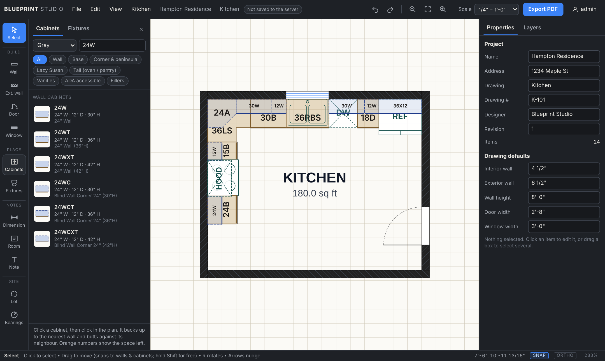
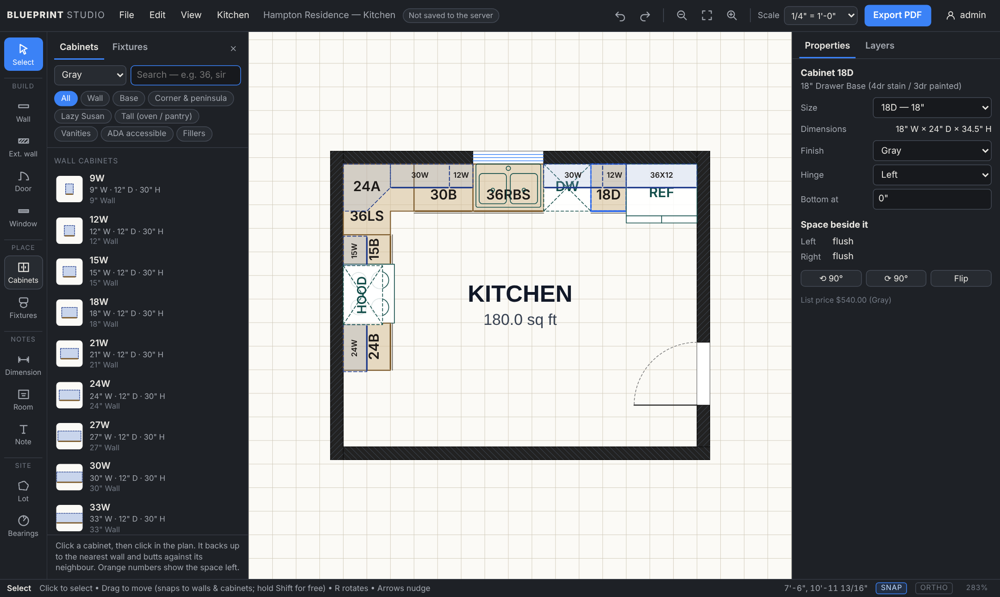
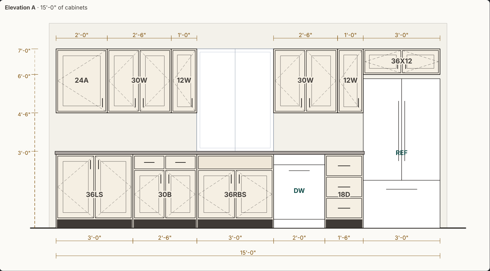

# Blueprint Studio

A browser-based floor-plan and kitchen-layout tool for a small team. Draw walls,
doors and windows to scale, lay out Kitchen Kompact cabinets and appliances
against those walls, and export a professional PDF set: the plan at true scale,
cabinet elevations, and a cabinet & appliance order list.

Everyone signs in. Drawings live on your server in personal folders and a shared
**Team** folder, with edit locks so two people never overwrite each other.



---

## Contents

- [Running it locally](#running-it-locally)
- [Hosting on your OVH server](#hosting-on-your-ovh-server)
- [Using Blueprint Studio](#using-blueprint-studio)
- [Kitchen layout](#kitchen-layout)
- [Keyboard shortcuts](#keyboard-shortcuts)
- [Configuration](#configuration)
- [Development](#development)

---

## Running it locally

```bash
python3 -m venv .venv && . .venv/bin/activate
pip install -r requirements.txt
python wsgi.py                 # http://127.0.0.1:5000
```

Sign in as **admin / 1234** (change it from the user menu, top right).

---

## Hosting on your OVH server

The app is a single small Python service. It keeps its data (accounts and
drawings) in one folder, `data/`, and sits behind the reverse proxy you already
use for your other apps. Nothing else to install — no database.

### 1. Get the code and configure it

```bash
sudo mkdir -p /opt/blueprintstudio && sudo chown $USER /opt/blueprintstudio
git clone https://github.com/HandyFox/blueprintstudio.git /opt/blueprintstudio
cd /opt/blueprintstudio
cp .env.example .env
nano .env        # pick a port, and optionally the first admin's name/password
```

### 2a. Run it with Docker (recommended)

```bash
sudo chown -R 1000:1000 data                # the container runs as uid 1000
docker compose up -d --build
curl http://127.0.0.1:8070/api/health      # {"ok": true, ...}
```

It listens on `127.0.0.1:8070` only (change `BPS_PORT` in `.env` if that port is
taken by another app). Drawings and accounts are in `/opt/blueprintstudio/data`.

### 2b. …or without Docker (systemd)

```bash
sudo useradd --system --home /opt/blueprintstudio bps
python3 -m venv .venv && .venv/bin/pip install -r requirements.txt
sudo chown -R bps:bps /opt/blueprintstudio
sudo cp deploy/blueprintstudio.service /etc/systemd/system/
sudo systemctl daemon-reload && sudo systemctl enable --now blueprintstudio
```

### 3. Put it behind your reverse proxy

**Own subdomain** (e.g. `plans.yourdomain.com`) with nginx:

```bash
sudo cp deploy/nginx-subdomain.conf /etc/nginx/sites-available/blueprintstudio
sudo nano /etc/nginx/sites-available/blueprintstudio        # set server_name
sudo ln -s /etc/nginx/sites-available/blueprintstudio /etc/nginx/sites-enabled/
sudo nginx -t && sudo systemctl reload nginx
sudo certbot --nginx -d plans.yourdomain.com                 # HTTPS
```

Point a DNS `A` record for the subdomain at the server in the OVH control panel
first.

**Under a path of an existing site** (e.g. `yourdomain.com/blueprints/`): paste
the block from `deploy/nginx-subpath.conf` into that site's `server { }`. The
app reads the `X-Forwarded-Prefix` header nginx sends and builds every link
and cookie for `/blueprints/`.

**Caddy** and **Traefik** examples are in `deploy/Caddyfile.example` and in the
comments of `docker-compose.yml`.

### Updating

```bash
cd /opt/blueprintstudio && ./deploy/update.sh
```

Pulls from GitHub and rebuilds/restarts. Your `data/` folder is untouched.

### Backups

Everything lives in `data/`. Back it up nightly:

```bash
crontab -e
15 3 * * * /opt/blueprintstudio/deploy/backup.sh /var/backups/blueprintstudio
```

(Keeps the last 30 snapshots.)

---

## Using Blueprint Studio



**Top bar** — File / Edit / View / Kitchen menus, the drawing's name and its
save state (*Not saved to the server*, *Team / house.bpsj*, *unsaved changes*,
*read-only*), undo/redo, zoom, the print scale, **Export PDF**, and your user
menu.

**Left rail** — the tools, grouped:

| Group | Tools |
|---|---|
| — | **Select** — click, Shift-click, or drag a box. Drag to move. |
| Build | **Wall**, **Ext. wall**, **Door**, **Window** |
| Place | **Cabinets**, **Fixtures** — open the library panel |
| Notes | **Dimension**, **Room** label, **Note** |
| Site | **Lot** lines, **Bearings** (survey calls) |

**Right panel** — *Properties* for whatever is selected (or the project info and
drawing defaults when nothing is), and *Layers* (hide, or lock so clicks pass
through).

### Walls

Pick **Wall** or **Ext. wall** and click corner to corner. For exact sizes,
type a length while drawing — `12'`, `12'6"`, `150`, `6 1/2"` — and press
Enter. A typed length is the **inside** face-to-face dimension; corners
automatically extend so the room measures what you typed. Walls within 5° of
square snap square (hold **Shift** for 15° steps, **F8** for strict ortho).
Double-click or right-click to stop. Click back on the first corner to close
the room.

Select a wall to edit its length, inside length, thickness and height, or drag
its end handles.

### Doors and windows

Hover a wall and click. Drag them along the wall afterwards; set width, height,
sill and swing in Properties.

### Room labels

Click inside a room. The area is measured from the surrounding wall faces and
filled in for you.

### Saving and sharing

- **File ▸ Save** (Ctrl+S) saves to the server — *My Files* (only you) or
  *Team* (everyone).
- **File ▸ Open from server** lists both folders. If someone else is editing a
  file you can open it **read-only** or **take over** (their copy becomes
  read-only and they're told).
- Your browser also keeps an automatic copy of the drawing you're working on,
  so a reload or a crash doesn't lose work.
- **Download a copy** / **Open file from this computer** handle `.bpsj` files.

### PDF export

**Export PDF** prints the plan at the chosen scale (top bar) so a scale rule on
the paper matches real dimensions. Pick the sheet size; if the plan doesn't fit,
choose a bigger sheet or a smaller scale, or tick *shrink to fit* (the scale bar
then shows the scale actually used). When the drawing has cabinets you can add
the elevation sheets and the cabinet & appliance list.

### Accounts

Admins get **Manage users** in the user menu: add users, reset passwords,
make/remove admins, delete users (their files stay). Everyone can change their
own password.

---

## Kitchen layout



1. **Draw the room** with its doors and windows.
2. Press **C** (or click **Cabinets**). Pick the finish and click a cabinet in
   the library — it stays selected so you can drop several.
3. **Move into the room near a wall.** The cabinet backs up to the wall with its
   doors facing the room, slides along it, and **snaps flush** to the cabinet,
   appliance, corner wall or door next to it. Orange dimensions show the space
   left on each side; a red outline means it would hit something (a window for
   a wall cabinet, a door, a tall pantry…).
4. Corner cabinets (36LS lazy susan, 24A diagonal wall cabinet) turn to fit
   whichever corner you put them in. **F** flips hinge side or corner hand,
   **R** rotates, **Shift** places freely (islands work too — cabinets snap
   side-by-side or back-to-back).
5. Press **X** (or **Fixtures**) for the refrigerator, range, dishwasher, sink,
   hood, microwave and so on. They snap the same way and show up in the
   elevations.
6. Select a cabinet to tune the run:
   - **Size** — swap to another width in the same series (30B → 33B) keeping
     its left end in place.
   - **Space beside it** — the gap to the next thing; **Close** slides it over,
     **Filler** drops a filler cut to the gap.
   - **Hinge**, **Finish**, mounting height (**Bottom at**).
7. **Kitchen ▸ Elevations** shows every wall run front-on: toe kicks, drawers,
   doors with hinge marks, countertops, wall cabinets at their real heights,
   appliances, the window behind, and width and height dimension strings.
8. **Kitchen ▸ Cabinet list** is the order sheet: quantity, model, size and
   L/R hinge counts per finish; fillers are rolled up into stock strips.
   Prices are off by default — tick *Show catalog list prices* if you want them.

Wall cabinets hang with their bottoms at 54" (18" over a 36" counter); short
ones (12–24") line their tops up at 84" for over-range / over-fridge use. Change
it per cabinet with **Bottom at**.

### Fixture library

| Category | Items |
|---|---|
| Kitchen appliances | Refrigerators 30/33/36", ranges 30/36", cooktop, dishwashers 18/24", range hoods 30/36", over-range microwave, wall oven |
| Sinks & countertop | Double and single bowl kitchen sinks, bar sink, vanity bowl |
| Laundry | Washer, dryer, stacked washer/dryer, laundry tub |
| Bathroom | Toilets (elongated/round), pedestal and wall-hung sinks, tubs 60×30/60×32, freestanding tub, showers 36×36/48×36/60×32, medicine cabinet |
| Mechanical | Furnace, air handler, boiler, water heaters 40/50 gal, tankless, softener, electrical panel, sump pit |
| Furniture | King/queen/full/twin beds, nightstand, dresser, sofa, armchair, dining table, round table, desk |

Add your own in `app/static/data/fixtures.json` — the same file drives the
screen and the PDF.

---

## Keyboard shortcuts

| Key | | Key | |
|---|---|---|---|
| V | Select | Ctrl+Z / Ctrl+Y | Undo / redo |
| W / E | Wall / exterior wall | Ctrl+S / Ctrl+Shift+S | Save / save as |
| D / N | Door / window | Ctrl+O | Open from server |
| C / X | Cabinets / fixtures | Ctrl+D | Duplicate (cabinets step along the run) |
| M | Dimension | Ctrl+P | Export PDF |
| L / T | Room label / note | Delete | Delete selection |
| P / B | Lot / bearings | R / Shift+R | Rotate selection ±90° |
| F | Zoom to drawing | Arrows | Nudge 1" (Shift = 1') |
| + / − | Zoom | Esc | Cancel / stop placing |
| F8 | Ortho | Space-drag, middle-drag | Pan |

---

## Configuration

Set in `.env` (Docker) or the environment:

| Variable | Default | |
|---|---|---|
| `BLUEPRINT_STUDIO_DATA_DIR` | `./data` | Accounts and drawings |
| `BLUEPRINT_STUDIO_PREFIX` | *(none)* | Serve under a path, e.g. `/blueprints`, when the proxy doesn't strip it |
| `BLUEPRINT_STUDIO_PROXY_HOPS` | `1` | Reverse proxies to trust for `X-Forwarded-*` (0 if exposed directly) |
| `BLUEPRINT_STUDIO_ADMIN_USER` | `admin` | First admin, created only when there's no `accounts.json` yet |
| `BLUEPRINT_STUDIO_ADMIN_PASSWORD` | `1234` | …and their password |
| `BPS_PORT` | `8070` | Host port (docker compose) |
| `GUNICORN_WORKERS` / `GUNICORN_THREADS` | `2` / `4` | Server tuning |

Data layout:

```
data/
├── accounts.json          users (PBKDF2-hashed passwords) + cookie signing key
└── projects/
    ├── admin/             personal folders
    ├── Penny/
    └── Team/              shared with everyone
```

PythonAnywhere still works: point the web app at `wsgi.py` and set
`BLUEPRINT_STUDIO_DATA_DIR` if you want the data outside the code folder.

---

## Development

```bash
pip install -r requirements.txt pytest
pytest -q                       # server, storage, locks, sub-path, PDF
for f in app/static/js/*.js; do node --check "$f"; done
```

```
app/
├── __init__.py            Flask app: sign-in, storage + lock API, PDF endpoint, proxy/prefix
├── lib/
│   ├── auth_storage.py    accounts.json, sessions, per-user + Team folders, edit locks
│   ├── pdf_export.py      plan, elevations, cabinet list (ReportLab)
│   └── units.py           feet-inches parsing/formatting
├── static/
│   ├── data/fixtures.json fixture library (shared by browser and PDF)
│   ├── css/app.css
│   └── js/
│       ├── app.js         menus, library panel, keyboard/mouse, files, PDF/elevation dialogs
│       ├── model.js       walls, openings, cabinets, fixtures, undo commands
│       ├── tools.js       select/move, wall, door/window, place, dimension, room, lot…
│       ├── placement.js   wall/neighbour snapping, gaps, collision by height
│       ├── elevations.js  wall runs → elevation drawings
│       ├── render.js      SVG plan renderer
│       ├── properties.js  inspector panel
│       ├── cabinets.js    Kitchen Kompact catalog
│       ├── symbols.js     fixture symbols
│       ├── bom.js         cabinet list
│       ├── cloud.js       server files, locks, accounts
│       └── ui.js          dialogs, toasts, API helper
└── templates/             index.html, login.html
deploy/                    nginx, Caddy, systemd, update + backup scripts
tests/                     pytest suite
```

### Version 2.0 changes

- New interface: menus, labelled tool rail, docked cabinet/fixture library,
  tabbed properties/layers, in-app dialogs instead of browser pop-ups.
- Fixture library (appliances, plumbing, laundry, HVAC, furniture).
- Kitchen layout: wall + neighbour snapping with live gap dimensions, height-aware
  collision warnings, correct corner cabinet footprints, size swaps, fillers,
  hinge sides, mounting heights, elevations, order list with optional prices.
- PDF: elevation sheets, plan elevation tags, cabinet & appliance list, open
  door leaves, unfilled wall cabinets.
- Fixes: cabinets couldn't be dragged or box-selected; cabinets snapped to a
  wall faced sideways; mirrored cabinets faced the wall; drags released off the
  canvas stuck; closing a room drawn with typed lengths left a corner open;
  lot double-click added a duplicate corner; re-opening a shared file dropped
  your own lock; the PDF clip warning printed a black box; accounts weren't
  shared between server processes.
- Hosting: Docker/gunicorn, reverse-proxy and sub-path support, update and
  backup scripts.
